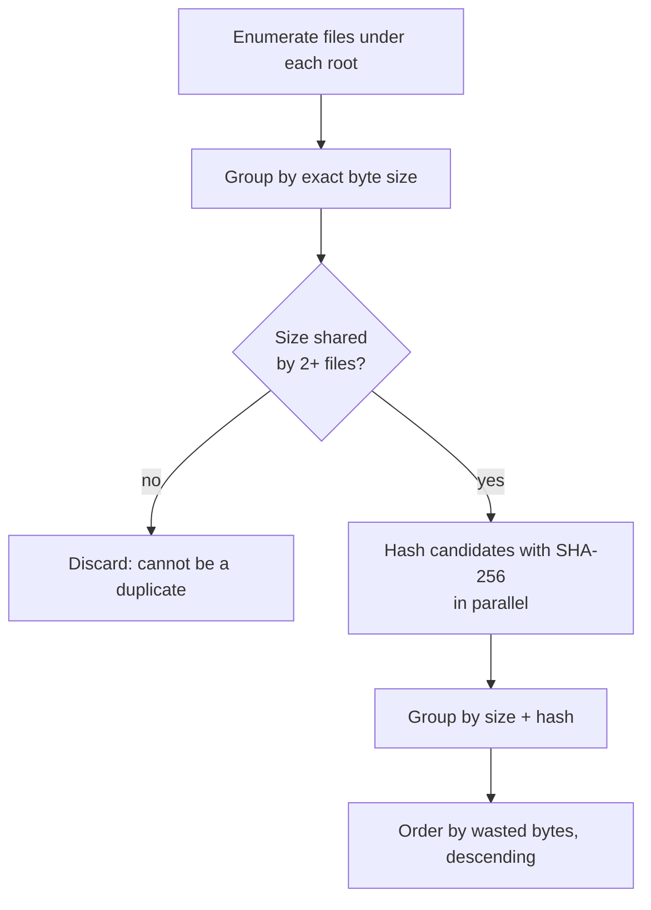

# DupFind

A Windows desktop app that finds byte-identical files across one or more folders, shows you
every copy, and moves the ones you don't want into a folder you choose.

[](https://github.com/adityashirsatrao007/dupfind/actions/workflows/build.yml)

Built with WPF on .NET 8. The scanning engine is a separate library with no UI dependency,
so the part that actually matters is covered by tests.

## What it does

- Scan any number of folders, including nested ones, in one pass
- Group results by content, not just name or size
- Tick individual copies, or use **Keep newest in each group** to auto-select every copy
  except the most recently modified one
- **Move selected** sends the ticked files to a quarantine folder instead of deleting them,
  so a mistake is recoverable
- **Export CSV** writes the full report (group, size, SHA-256, path) for review outside the app
- Cancel a long scan at any point; files that can't be read are counted and skipped rather
  than aborting the run

## How the scan works

Hash everything and a folder scan becomes I/O bound for no reason. DupFind narrows the
candidate set first:



Two files that differ in size can never be identical, so only files that share a size get
hashed. On a typical mix of documents and photos that skips hashing the large majority of
the disk.

| Decision | Choice | Why |
| --- | --- | --- |
| Duplicate test | Full SHA-256 | Correctness first. A 4 KB partial hash before the full one is the obvious next optimisation; it was left out to keep the engine small and easy to verify. |
| Deletion | Move to a quarantine folder | Permanent deletion in a duplicate finder is one mis-tick away from data loss. `File.Move` is also entirely reversible. |
| Zero-byte files | Ignored | They are trivially "identical" and never worth reporting. |
| Overlapping roots | De-duplicated by path | Passing `C:\Photos` and `C:\Photos\2024` must not report the same file twice. |
| Symlinks / junctions | Skipped | Following a junction can loop forever and report one file many times. |
| MVVM | Hand-rolled, ~60 lines | No framework dependency, and every line is explainable in an interview. |
| Dialogs | Called directly from the view model | Keeps the app small. Extracting an `IDialogService` is the first step if the view models need their own tests. |

## Layout

```
src/
  DupFind.Core/          scanning engine — net8.0, no UI types, fully testable
    DuplicateFinder.cs   enumeration, size pass, parallel SHA-256 pass
    Models.cs            ScanProgress, DuplicateGroup, ScanResult
  DupFind.App/           WPF UI — net8.0-windows
    ViewModels/          MainViewModel, DuplicateGroupViewModel, DuplicateFileViewModel
    Mvvm/                ObservableObject, RelayCommand, AsyncRelayCommand
    MainWindow.xaml      folders, toolbar, grouped results, status bar
tests/
  DupFind.Core.Tests/    xUnit, runs on any OS
```

`DupFind.Core` is deliberately OS-agnostic. All nine tests run on Linux and Windows, which
is why the engine can be verified in CI without a desktop session.

## Build and run

Requires the [.NET 8 SDK](https://dotnet.microsoft.com/download/dotnet/8.0).

```powershell
dotnet build
dotnet run --project src/DupFind.App
```

Run the tests:

```bash
dotnet test
```

The app runs as a framework-dependent `win-x64` build; CI publishes it on every push and
attaches the output as the `DupFind-win-x64` artifact. To build a standalone folder:

```powershell
dotnet publish src/DupFind.App/DupFind.App.csproj -c Release -r win-x64 --self-contained false -o publish
```

## Tests

| Test | What it guards |
| --- | --- |
| `FindsIdenticalFilesAcrossNestedFolders` | Recursion, grouping, and the reclaimable-bytes total |
| `SameSizeDifferentContentIsNotADuplicate` | The size pass is a filter, not the answer |
| `ZeroByteFilesAreIgnored` | Empty files never show up as results |
| `OverlappingRootsDoNotDoubleCountAFile` | Path de-duplication across roots |
| `MissingFolderIsReportedAndTheRestOfTheScanContinues` | Bad input degrades, it doesn't throw |
| `EmptyFolderProducesAnEmptyResult` | The happy path for nothing found |
| `CancellationStopsTheScan` | The cancel token actually interrupts |
| `ProgressEndsAtOneHundredPercent` | Progress reporting counts candidates, not all files |
| `ScanResultReclaimableBytesIgnoresTheLastCopy` | You can't reclaim the copy you keep |

## What I'd do next

- Partial-hash pre-check (first 4 KB, then full hash) to cut I/O on large media files
- A scan cache keyed by `(path, size, last write time)` so repeat scans skip unchanged files
- Multi-select with Shift-click in the results list
- Move-to-quarantine as a single transaction, so a mid-run failure can be rolled back
- Extract `IDialogService` and unit-test `MainViewModel` selection logic

## License

MIT — see [LICENSE](LICENSE).
