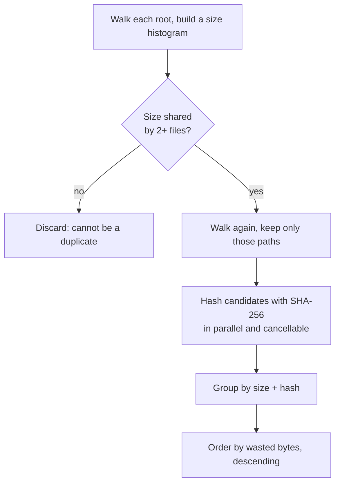

# DupFind

A Windows desktop app that finds byte-identical files across one or more folders, shows you
every copy, and moves the ones you don't want into a folder you choose.

[](https://github.com/adityashirsatrao007/dupfind/actions/workflows/build.yml)

Built with WPF on .NET 8. The scanning engine is a separate library with no UI dependency,
so the part that actually matters is covered by tests.

## What it does

- Scan any number of folders, including nested ones, in one pass
- Group results by content, not just name or size
- Tick individual copies, or use **Keep newest in each group** to auto-select every copy
  except the most recently modified one
- **Move selected** sends the ticked files to a quarantine folder instead of deleting them,
  so a mistake is recoverable
- **Export CSV** writes the full report (group, size, SHA-256, path) for review outside the app
- Cancel a long scan at any point; files that can't be read are counted and skipped rather
  than aborting the run

## How the scan works

Hashing everything makes a folder scan I/O bound for no reason, and holding every path in
memory makes it unbounded. DupFind does neither:



Two files that differ in size can never be identical, so only files that share a size are
hashed — on a typical mix of documents and photos that skips the large majority of the disk.

The second walk is the deliberate part. A single pass that keeps every path is fine on a small
folder and falls over on a large drive: the histogram keeps memory proportional to the number
of *duplicates*, not the number of *files*. The price is metadata reads on the second walk,
which the OS cache usually absorbs and which are cheap next to hashing.

| Decision | Choice | Why |
| --- | --- | --- |
| Duplicate test | Full SHA-256 | Correctness first. A 4 KB partial hash before the full one is the obvious next optimisation; it was left out to keep the engine small and easy to verify. |
| Enumeration | Two walks; paths kept only for candidates | Memory proportional to duplicates instead of to every file on the volume |
| Deletion | Move to a quarantine folder | Permanent deletion in a duplicate finder is one mis-tick away from data loss. `File.Move` is also entirely reversible. |
| Zero-byte files | Ignored | They are trivially "identical" and never worth reporting. |
| Overlapping roots | De-duplicated by path | Passing `C:\Photos` and `C:\Photos\2024` must not report the same file twice. |
| Symlinks / junctions | Skipped | Following a junction can loop forever and report one file many times. |
| MVVM | Hand-rolled, ~60 lines | No framework dependency, and every line is explainable in an interview. |
| Dialogs | Called directly from the view model | Keeps the app small. Extracting an `IDialogService` is the first step if the view models need their own tests. |

## Layout

```
src/
  DupFind.Core/          scanning engine — net8.0, no UI types, fully testable
    DuplicateFinder.cs   enumeration, size pass, parallel SHA-256 pass
    Models.cs            ScanProgress, DuplicateGroup, ScanResult
  DupFind.ViewModels/    presentation rules — net8.0, no WPF, testable on any OS
    DuplicateGroupViewModel.cs  KeepNewest, group resolution, header text
    DuplicateFileViewModel.cs   one file and its selection state
    Format.cs                   byte sizes for the UI
  DupFind.App/           WPF UI — net8.0-windows
    ViewModels/          MainViewModel: commands, dialogs, progress
    Mvvm/                RelayCommand, AsyncRelayCommand
    MainWindow.xaml      folders, toolbar, virtualized grouped results, status bar
tests/
  DupFind.Core.Tests/         xUnit, runs on any OS
  DupFind.ViewModels.Tests/   xUnit, runs on any OS
```

`DupFind.Core` and `DupFind.ViewModels` are deliberately OS-agnostic, so all 25 tests run on
Linux and Windows. That split is what makes the presentation rules testable: a WPF test needs a
desktop session, an `INotifyPropertyChanged` test does not.

## Operational behaviour

- **Moves run off the UI thread** with a progress bar and a cancel button. Files already moved
  stay moved if you cancel, and the grid is updated for exactly those files — no phantom rows.
- **Unreadable files are listed, not hidden.** *Skipped files…* shows every path the scan could
  not read: locked file, permission denied, disconnected drive.
- **Unexpected errors are logged** to `%AppData%\DupFind\crash.log` and surfaced in a dialog,
  so a failure never closes the window silently.
- **Results virtualize.** The results list is a `ListBox` with a recycling
  `VirtualizingStackPanel`, and a finished scan is published to the grid in a single
  assignment. A 100 000-file scan therefore costs one layout pass and about a screenful of
  controls, instead of 200 000 controls and a frozen window.
- **No single-instance guard** — two copies can run at once. Unlike ExpenseLog there is no
  shared mutable state, so this is harmless today.

## Download and run

Every push to `main` publishes a single self-contained `DupFind.exe` for `win-x64`. The .NET
runtime is bundled, so nothing needs to be installed first. Download it from the artifacts of
the latest green run: **Actions → the newest `build` run → Artifacts → `DupFind-win-x64`**.

The executable is unsigned, so SmartScreen warns on first launch: *More info → Run anyway*.

## Build and run

Requires the [.NET 8 SDK](https://dotnet.microsoft.com/download/dotnet/8.0).

```powershell
dotnet build
dotnet run --project src/DupFind.App
```

Run the tests:

```bash
dotnet test
```

CI publishes the self-contained single file on every push and attaches it as the
`DupFind-win-x64` artifact. To reproduce it locally:

```powershell
dotnet publish src/DupFind.App/DupFind.App.csproj -c Release -r win-x64 `
  --self-contained true -p:PublishSingleFile=true `
  -p:IncludeNativeLibrariesForSelfExtract=true -p:EnableCompressionInSingleFile=true `
  -p:DebugType=embedded -o publish
```

`DebugType=embedded` keeps stack traces in `crash.log` readable without shipping a second file,
and the CI step *Verify single-file output* fails the build if single-file ever stops applying.

## Tests

| Test | What it guards |
| --- | --- |
| `FindsIdenticalFilesAcrossNestedFolders` | Recursion, grouping, and the reclaimable-bytes total |
| `SameSizeDifferentContentIsNotADuplicate` | The size pass is a filter, not the answer |
| `ZeroByteFilesAreIgnored` | Empty files never show up as results |
| `OverlappingRootsDoNotDoubleCountAFile` | Path de-duplication across roots |
| `MissingFolderIsReportedAndTheRestOfTheScanContinues` | Bad input degrades, it doesn't throw |
| `EmptyFolderProducesAnEmptyResult` | The happy path for nothing found |
| `CancellationStopsTheScan` | The cancel token actually interrupts |
| `ProgressEndsAtOneHundredPercent` | Progress reporting counts candidates, not all files |
| `ScanResultReclaimableBytesIgnoresTheLastCopy` | You can't reclaim the copy you keep |

Presentation rules (`DupFind.ViewModels.Tests`, 16 cases, no desktop session required):

| Test | What it guards |
| --- | --- |
| `KeepNewest_selects_every_copy_except_the_most_recently_written` | The bulk action's whole contract |
| `KeepNewest_never_selects_the_only_newest_file_when_timestamps_tie` | Equal timestamps still keep exactly one copy |
| `ClearSelection_deselects_everything` | *Deselect all* really clears |
| `Selecting_a_copy_raises_selection_changed` | The toolbar selection counter updates |
| `RemoveFiles_reports_the_group_as_resolved_below_two_copies` | Moved rows leave the list |
| `RemoveFiles_leaves_a_still_duplicated_group_flagged` | A partially moved group stays visible |
| `Header_reports_copies_reclaimed_bytes_and_folder` | The expander header |
| `SelectedFiles_returns_only_the_ticked_copies` | What *Move selected…* acts on |
| `Bytes_*` (3 cases) | Size text, unit selection, sign |

## What I'd do next

- Partial-hash pre-check (first 4 KB, then full hash) to cut I/O on large media files
- A scan cache keyed by `(path, size, last write time)` so repeat scans skip unchanged files
- Multi-select with Shift-click in the results list
- Move-to-quarantine as a single transaction, so a mid-run failure can be rolled back
- Extract `IDialogService` so `MainViewModel` itself — commands, progress, cancellation —
  becomes testable; today only the group and file view models are

## License

MIT — see [LICENSE](LICENSE).
